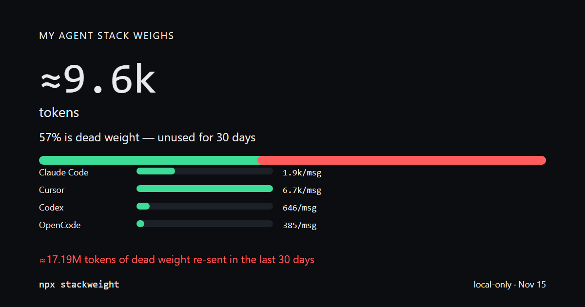

# StackWeight

**The bundle-size report for your agent stack.** One command weighs every skill, plugin, command and subagent you've installed across Claude Code, Cursor, Codex and OpenCode, tells you what to keep, and prunes the rest safely.

```bash
npx stackweight
```

No config. No account. No network calls. Nothing leaves your machine.



The card is the real 1200×630 share card, rendered from a scan of the maintainer's own machine: four agents, 112 items, one command, no config. It never shows skill names or paths. The animated GIF is recorded from `demo/demo.tape`.

## Why

Every installed skill puts its name and description into your agent's context on **every message**, used or not. Install fifty, use five, and you pay for fifty, on every turn and in every session. StackWeight shows you the bill.

```
Stack weight   9.6k tokens of always-on context, combined across 4 agents (≈)
Dead weight    5.4k tokens · 57% · unused for 30 days, safe to prune
Re-sent in the last 30 days: ≈ 17.19M tokens of dead weight
```

## What you get for every item

| Column | What it means |
|---|---|
| **Weight** | Tokens this item adds to every message, per agent that loads it |
| **Usage** | Times used in the last 30 days and when last used, read from your agents' local logs, or **unknown** if there are no readable logs. We never guess. |
| **Overlap** | Other items whose descriptions promise the same job and compete to be triggered, with a recommended survivor |
| **Health** | Patterns worth a look: instruction-override phrasing, hidden Unicode, reading credentials, piping downloads into a shell |
| **Verdict** | KEEP · DISABLE · ARCHIVE · MERGE, with the reason in one sentence |

## Prune, safely

```bash
npx stackweight prune          # shows the plan, asks before touching anything
npx stackweight restore        # undoes the last prune, exactly
npx stackweight restore --item brand-voice   # bring back one item
```

Pruning **moves** items to `~/.stackweight/parked/` (or flips a plugin's enabled flag) after recording a manifest. Nothing is deleted. StackWeight never prunes built-ins, project skills, items it has no usage data for, or anything installed in the last 14 days.

## Share your receipt

`npx stackweight` writes an HTML report with a share card: your weight, your dead share, and your before → after once you've pruned. The card never shows skill names or file paths.

## Keep it lean in CI

```bash
npx stackweight --budget 8000   # exits 2 if any agent's always-on weight exceeds 8k tokens
```

## How we measure

Tokens are counted locally with the o200k tokenizer over the exact listing text each agent injects. Absolute numbers are estimates (your model's tokenizer differs); percentages and rankings are stable. Usage comes only from tool calls in your local logs, never from system prompts. Full details: [docs/METHODOLOGY.md](docs/METHODOLOGY.md).

| Agent | Inventory | Usage source |
|---|---|---|
| Claude Code | skills, commands, subagents, plugins | `~/.claude/projects` session logs |
| Cursor | skills, plugins | agent transcripts (dated by file time) |
| Codex | skills | `~/.codex/sessions` rollouts |
| OpenCode | skills, agents, commands | local `opencode.db` (read-only), when readable |

`npx stackweight sources` prints exactly what was read and what was missing. Paste it into an issue if something looks wrong.

## Offline install

```bash
npm pack stackweight && npm install -g ./stackweight-*.tgz   # on a connected machine, then copy the .tgz
```

## License

MIT

Rewind: `npx stackweight restore` undoes the last prune, exactly. One item comes back with `npx stackweight restore --item <name>`. Nothing was deleted.
